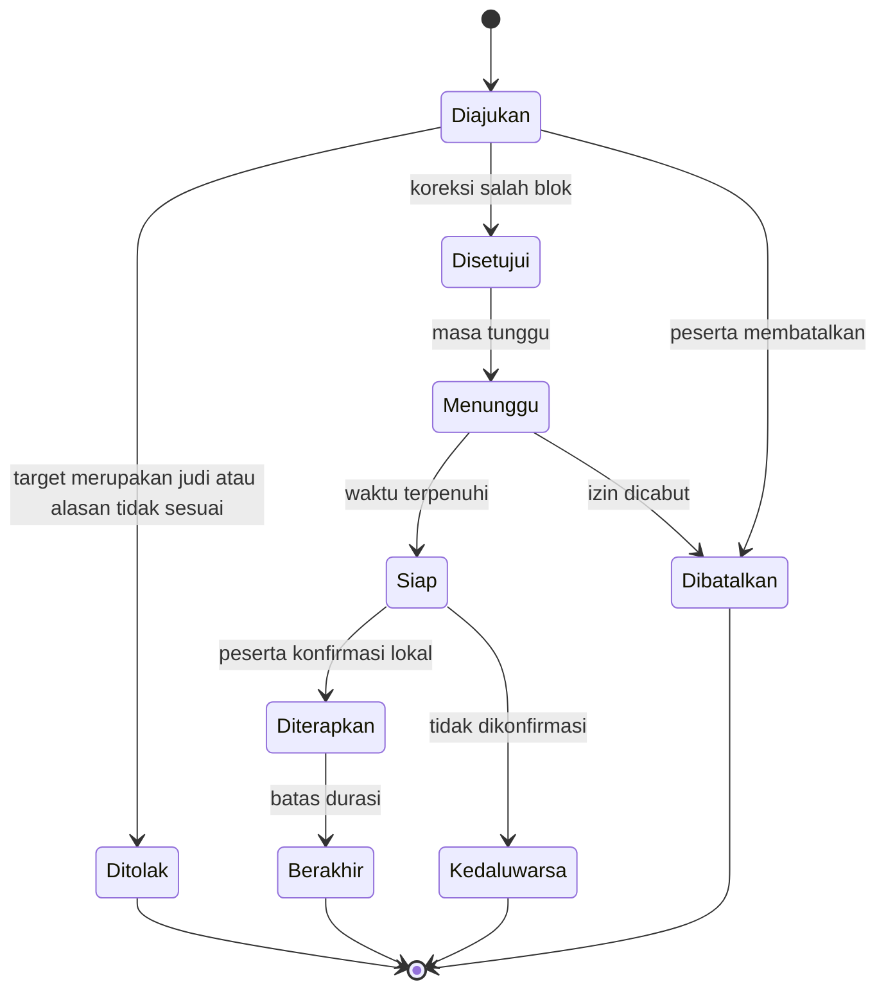

# PRD — Gempur

| Atribut | Nilai |
| --- | --- |
| Versi | 0.1 |
| Tanggal | 9 November 2026, WIB |
| Status | Draf spesifikasi produk; siap untuk desain, validasi teknis, dan perencanaan implementasi |
| Pemilik kebutuhan | Pemilik repository Gempur |
| Fokus | Mengurangi akses judi online dan memudahkan dukungan keluarga |
| Pengguna awal | Peserta dewasa yang memakai Android dan bersedia didampingi |
| Perangkat pendamping | Browser di HP Android atau iPhone |
| Pilot yang diusulkan | Satu pasangan peserta–pendamping, 14 hari setelah validasi teknis |
| Bahasa produk | Bahasa Indonesia |

> Dokumen ini menetapkan perilaku produk yang diinginkan. Angka target, durasi, stack, dan tahapan yang berlabel usulan belum merupakan hasil pengujian atau keputusan pengguna. Pinjol dan pengelolaan utang berada di luar versi ini.

## 1. Ringkasan keputusan

Bangun aplikasi Android yang membantu pemilik HP membatasi akses judol di perangkatnya sendiri, disertai dashboard pendamping yang menerima informasi yang secara jelas dipilih untuk dibagikan peserta.

Produk memiliki tiga fungsi utama:

1. **Mengurangi akses:** memblokir domain judi yang telah masuk daftar lokal, tanpa bergantung pada dashboard pendamping.
2. **Membantu saat dorongan muncul:** menyediakan tombol meminta dukungan dan rencana kegiatan pengalihan yang ditentukan peserta.
3. **Membantu pendamping bertindak:** menampilkan permintaan bantuan, ringkasan yang dibagikan, dan permintaan koreksi blok yang keliru.

**Keputusan distribusi:** versi dasar menggunakan proteksi lokal dan pengiriman informasi yang dipicu peserta. Pemantauan aktivitas dewasa secara otomatis ke HP orang lain bukan komitmen MVP. Kebijakan Google Play membatasi penggunaan aplikasi monitoring orang lain, termasuk terhadap orang dewasa yang menyetujui. Fitur berbagi sukarela juga harus dinilai berdasarkan implementasinya; tidak dianggap otomatis disetujui. [S1]

**Keputusan kendali:** persetujuan pendamping memberi friksi pada perubahan aturan di dalam aplikasi. Produk tidak menjanjikan tidak dapat dihapus, tidak dapat dimatikan, atau mampu mengunci seluruh Settings Android. [S2]

**Keputusan hasil:** aplikasi merupakan alat bantu pendampingan. Jumlah blok dan nihilnya laporan tidak membuktikan peserta berhenti berjudi atau pulih.

## 2. Masalah yang diselesaikan

Peserta dapat mengalami dorongan berjudi berulang melalui browser, tautan pesan, atau aplikasi. Keluarga sulit membantu pada saat yang tepat, sedangkan pemblokir biasa dapat dihentikan ketika dorongan sedang tinggi.

Permasalahan produk:

| Masalah | Kebutuhan pengguna |
| --- | --- |
| Akses ke judol mudah dan berulang | Hambatan akses yang bekerja sepanjang mekanisme proteksi lokal aktif |
| Dorongan muncul ketika sendirian | Cara cepat meminta pendampingan tanpa harus menjelaskan panjang |
| Keluarga terlambat mengetahui kebutuhan bantuan | Permintaan dukungan yang jelas, dengan status pengiriman yang jujur |
| Situs normal ikut terblokir | Koreksi terarah yang tidak membuka seluruh proteksi |
| Informasi teknis mudah disalahartikan | Status yang memisahkan kondisi perangkat, data lama, dan laporan peserta |
| Pemantauan berlebihan merusak kepercayaan | Persetujuan yang jelas, data minimal, serta kendali untuk berhenti berbagi |

Pemblokiran tidak menyelesaikan seluruh penyebab kecanduan. Layanan pemulihan dapat melibatkan konseling individu dan keluarga; produk perlu mendukung akses ke bantuan profesional tanpa mengklaim sebagai terapi. [S9]

## 3. Fakta yang dikonfirmasi dan asumsi kerja

| Jenis | Pernyataan |
| --- | --- |
| Kebutuhan produk | Membatasi akses judol dan mendukung pendampingan sukarela. |
| Platform awal | Android. |
| Prasyarat produk | Peserta dewasa memasang aplikasi dan menyepakati pendampingan secara sukarela. |
| Dikonfirmasi | Pengguna ingin PRD Markdown dengan fokus judol terlebih dahulu. |
| Asumsi | Peserta berusia 18 tahun atau lebih; dikonfirmasi saat onboarding sebelum pilot. |
| Asumsi | Versi awal mendukung satu peserta, satu HP Android, dan satu pendamping utama. |
| Asumsi | HP peserta tidak di-root dan bukan perangkat enterprise yang dikelola. |
| Asumsi | Pendamping dapat membuka browser modern; tidak perlu aplikasi native pendamping. |
| Belum diketahui | Merek HP, versi Android, browser utama, VPN lain, dan aplikasi penting peserta. |
| Belum diketahui | Anggaran, tim, target tanggal rilis, dan jalur distribusi yang diterima. |

Informasi perangkat yang belum diketahui menjadi tugas validasi, bukan alasan menunda penyusunan PRD atau mengasumsikan semua Android kompatibel.

## 4. Tujuan dan batas cakupan

### Tujuan MVP

- Membatasi koneksi ke domain judi yang dikenali pada konfigurasi yang telah diuji.
- Membantu peserta meminta dukungan sebelum atau setelah kejadian berjudi.
- Memberi pendamping konteks yang disepakati, dengan tindakan lanjutan yang jelas.
- Menjaga fungsi HP sehari-hari dan privasi peserta.
- Menghasilkan bukti kelayakan teknis serta kegunaan melalui pilot kecil.

### Di luar MVP

- Pinjol, paylater, daftar utang, penagihan, dan restrukturisasi utang.
- Integrasi rekening, pembatasan transfer, pembatalan deposit, atau persetujuan transaksi bank.
- Pemasangan dari jarak jauh tanpa interaksi pemilik HP.
- Membaca chat, SMS, OTP, notifikasi bank, isi layar, kamera, mikrofon, atau lokasi.
- Riwayat browsing lengkap, perekaman layar, dan pemantauan tersembunyi.
- Root, jailbreak, factory reset wajib, atau enrollment Device Owner/MDM.
- Perlindungan HP kedua, perangkat pinjaman, judi offline, atau semua akun peserta.
- Aplikasi peserta untuk iOS dan pemantauan anak.
- AI pendeteksi kecanduan, diagnosis, terapi otomatis, atau skor kepatuhan.
- Pemblokiran seluruh iklan judol dan seluruh isi aplikasi media sosial.
- Membuka akses judi melalui tombol persetujuan pendamping.

Tidak ada klaim “100% anti-bypass”, “pasti berhenti judi”, atau “hari bebas judi terverifikasi”.

## 5. Pengguna dan pekerjaan utama

| Peran | Pekerjaan utama | Hak |
| --- | --- | --- |
| Peserta | Mengurangi akses judol, meminta dukungan, mengevaluasi kebiasaan | Mengaktifkan proteksi, memilih data yang dibagikan, menyetujui pairing, mencabut berbagi |
| Pendamping | Memberi dukungan yang disepakati tanpa memegang seluruh HP | Melihat data yang telah dibagikan, merespons bantuan, meninjau koreksi blok |
| Pengelola daftar blok | Menjaga relevansi dan kualitas aturan | Memverifikasi usulan domain dan menerbitkan daftar; tidak melihat catatan pribadi secara default |
| Pengelola teknis | Menjaga layanan dan menangani gangguan | Mengakses metadata operasional yang diperlukan, dengan audit akses |

Contoh user story:

- Sebagai peserta, saya ingin akses ke domain judi yang dikenali dibatasi walaupun dashboard tidak dapat dihubungi.
- Sebagai peserta, saya ingin meminta ditemani ketika dorongan berjudi naik.
- Sebagai pendamping, saya ingin tahu permintaan apa yang perlu saya tanggapi.
- Sebagai peserta, saya ingin memperbaiki blok situs normal tanpa membuka semua situs judi.
- Sebagai peserta, saya ingin menghentikan berbagi data tanpa kehilangan pilihan menggunakan pemblokir lokal.

## 6. Tahapan kemampuan produk

| Tahap | Cakupan | Syarat masuk |
| --- | --- | --- |
| Validasi awal | Prototipe filtering lokal, izin Android, konflik VPN, dan evaluasi distribusi | Perangkat nyata tersedia; daftar uji dan data flow disepakati |
| MVP dasar | Blok domain lokal, rencana dukungan, pairing, check-in, ringkasan yang dikirim peserta, koreksi blok | Validasi filtering dan model berbagi telah selesai |
| Peningkatan bersyarat | Blok jaringan aplikasi pilihan dan interupsi saat aplikasi dibuka | Mekanisme terbukti di perangkat target dan penggunaan API diterima |
| Riset lanjutan | Pembaruan status/kejadian otomatis ke pendamping | Model produk dan distribusi diterima secara terdokumentasi; izin terpisah |

**Ketentuan:** jika fitur bersyarat belum lolos, dokumentasi rilis dan UI tidak boleh menampilkannya sebagai kemampuan aktif. Jalur sideload atau label parental control tidak dipakai untuk menghindari evaluasi penggunaan dewasa.

## 7. Pengalaman utama

### 7.1 Mulai menggunakan

1. Peserta membaca fungsi, batas cakupan, dan data yang diproses.
2. Peserta memilih tujuan pribadi serta tindakan pengalihan, misalnya berjalan sebentar atau menghubungi pendamping.
3. Aplikasi meminta izin sistem hanya untuk fungsi yang dipilih.
4. Aplikasi menjelaskan konflik jika VPN lain aktif.
5. Peserta menjalankan tes blok menggunakan domain uji aman milik produk.
6. Peserta membuat undangan pendamping dan melihat identitas calon pendamping sebelum menyetujui.
7. Peserta memilih kategori berbagi; default tidak mengirim aktivitas jaringan secara otomatis.
8. Kedua pihak melihat ringkasan kesepakatan, batas waktu respons, dan cara mencabut akses.

Mode lokal dapat digunakan tanpa membuat akun. Akun diperlukan ketika peserta memakai fitur pendamping.

### 7.2 Ketika akses terblokir

- Filtering menolak koneksi pada target yang cocok dengan aturan.
- Aplikasi tidak memuat konten judol untuk menjelaskan blok.
- Jika memungkinkan, aplikasi memberi notifikasi lokal berisi akses ke halaman dukungan.
- Jika browser hanya menampilkan kegagalan koneksi, aplikasi tidak menjanjikan dapat mengganti semua halaman HTTPS dengan halaman interupsi.
- Peserta dapat membuka aplikasi untuk meminta dukungan atau melaporkan blok yang keliru.
- Kejadian jaringan dicatat sebagai permintaan yang diblokir, bukan kesimpulan bahwa peserta sengaja berjudi.

### 7.3 Ketika ingin berjudi

1. Peserta menekan “Saya butuh ditemani”.
2. Peserta memilih permintaan singkat, misalnya “Bisa telepon saya?”.
3. Aplikasi menampilkan pratinjau penerima dan isi.
4. Setelah peserta mengirim, UI menampilkan status pengiriman.
5. Sambil menunggu, peserta dapat membuka rencana pengalihan yang sudah dipilih.
6. Jika pendamping belum merespons, tersedia tombol membuka dialer atau aplikasi pesan secara manual.

Produk tidak menjanjikan pendamping tersedia 24 jam atau berfungsi sebagai layanan darurat.

### 7.4 Setelah kejadian berjudi

Peserta dapat mencatat kejadian secara sukarela, memilih apakah ingin membagikannya, dan menyusun langkah berikutnya. UI tidak menghapus seluruh progres, memberi hukuman, atau menyimpulkan kegagalan pribadi.

## 8. Kebutuhan fungsional

P0 wajib sebelum pilot MVP. P1 bersyarat atau setelah fondasi stabil. Setiap batasan harus terlihat ketika relevan.

| ID | Prioritas | Kebutuhan | Kriteria penerimaan |
| --- | --- | --- | --- |
| FR-01 | P0 | Persetujuan terpisah untuk proteksi dan berbagi | Peserta dapat menolak berbagi dan tetap memakai proteksi lokal. Tidak ada kotak persetujuan yang tercentang otomatis. |
| FR-02 | P0 | Filtering domain lokal | Semua fixture domain yang diblokir ditolak di konfigurasi yang dinyatakan didukung; fixture normal tetap dapat diakses. |
| FR-03 | P0 | Proteksi independen dari backend | Ketika API produk mati, daftar lokal terakhir tetap dipakai selama layanan proteksi dan jalur DNS/jaringan yang diperlukan bekerja. |
| FR-04 | P0 | Pembaruan daftar terverifikasi | Paket aturan bertanda tangan, berversi, dan diterapkan secara atomik; paket rusak tidak menggantikan versi yang valid. |
| FR-05 | P0 | Tambah blok lokal | Peserta dapat menambah domain; normalisasi domain dan subdomain diuji; path/query tidak disimpan. |
| FR-06 | P0 | Status proteksi lokal | UI membedakan aktif pada cakupan teruji, izin perlu diperiksa, VPN tergantikan, dan kondisi belum dapat diverifikasi. |
| FR-07 | P0 | Pairing | Token undangan acak minimal 128 bit, sekali pakai, kedaluwarsa 10 menit; peserta mengonfirmasi identitas pendamping. |
| FR-08 | P0 | Ringkasan berbagi sukarela | Peserta melihat pratinjau dan menekan Kirim untuk setiap snapshot; server tidak mengunggah histori aktivitas diam-diam. |
| FR-09 | P0 | Dashboard pendamping | Menampilkan snapshot terakhir, waktu dibuat/dikirim, dan label “bukan status langsung”; tidak menampilkan data peserta lain. |
| FR-10 | P0 | Permintaan dukungan | Bedakan menunggu koneksi, diterima server, dan dibaca dalam aplikasi. Push terkirim tidak dianggap sudah dibaca manusia. |
| FR-11 | P0 | Check-in singkat | Peserta dapat mencatat dorongan 0–10 dan kejadian berjudi, melewati pertanyaan, menyimpan lokal, atau memilih membagikan. |
| FR-12 | P0 | Koreksi salah blok | Permintaan ditujukan ke satu domain yang dilaporkan bukan judi; tidak ada tombol membuka seluruh daftar judi. |
| FR-13 | P0 | Persetujuan koreksi | Persetujuan terikat peserta, target, durasi, versi aturan, dan waktu kedaluwarsa; tetap perlu konfirmasi lokal peserta. |
| FR-14 | P0 | Cabut akses pendamping | Pengiriman baru berhenti segera di perangkat peserta; setelah server menerima pencabutan, akses pendamping ditolak. Tidak perlu izin pendamping. |
| FR-15 | P0 | Hapus data/akun | Peserta dapat meminta penghapusan; aplikasi menjelaskan data yang pernah diunduh penerima tidak dapat ditarik kembali. |
| FR-16 | P0 | Laporan domain terlewat | Peserta dapat mengirim domain secara sengaja setelah pratinjau; domain masuk antrean verifikasi sebelum daftar global berubah. |
| FR-17 | P0 | Rencana dukungan | Peserta menyimpan tindakan pengalihan dan kontak pilihan secara manual; tidak perlu membaca seluruh buku kontak. |
| FR-18 | P1 bersyarat | Blok jaringan aplikasi | Uji membuktikan koneksi aplikasi pilihan dibatasi; UI menyebut pembatasan jaringan, bukan mencegah aplikasi terbuka. |
| FR-19 | P1 bersyarat | Interupsi aplikasi | Hanya setelah validasi API dan kebijakan; tanpa membaca teks layar atau menekan tombol di aplikasi keuangan. |
| FR-20 | Riset | Status/kejadian otomatis | Tidak diaktifkan sebelum gate distribusi dan evaluasi data selesai; bukan dependency fitur dasar. |

Usulan parameter awal adalah konfigurasi pilot, bukan terapi yang telah dibuktikan.

## 9. Koreksi blok, masa tunggu, dan penghentian proteksi

Tiga alur harus dipisahkan:

| Alur | Perilaku |
| --- | --- |
| Situs normal salah terblokir | Ajukan koreksi target tertentu, tinjau, tunggu bila disepakati, lalu terapkan pengecualian terbatas |
| Dorongan ingin mengakses judi | Arahkan ke permintaan dukungan dan rencana pengalihan; tidak membuat pengecualian judi |
| Ingin berhenti memakai aplikasi/berbagi | Sediakan kendali yang jelas; jangan memblokir pencabutan persetujuan atau mengganggu kendali OS |

Usulan pilot: koreksi yang disetujui memiliki masa tunggu 10 menit dan berlaku maksimal 30 menit sebelum evaluasi ulang. Tidak ada persetujuan otomatis ketika pendamping tidak merespons. Koreksi permanen masuk proses kurasi daftar.

Koreksi mendesak untuk layanan penting menggunakan alur pemulihan yang jelas dan dapat dibatalkan. Jika pemulihan terarah gagal, peserta tetap dapat menghentikan proteksi lokal atau mengubah pengaturan OS. Produk menjelaskan konsekuensinya tanpa menahan perangkat.

Token koreksi sekali pakai, terikat target dan versi consent. Perubahan waktu HP tidak boleh mempersingkat masa tunggu; jika waktu tepercaya tidak tersedia, keputusan ditunda dengan status yang jelas.

## 10. Model status yang jujur

Status teknis lokal dan informasi yang dilihat pendamping adalah dua hal berbeda.

| Kondisi | Tampilan yang diizinkan | Kesimpulan yang dilarang |
| --- | --- | --- |
| Tes lokal berhasil | “Proteksi aktif pada cakupan yang diuji” | Semua judol pasti terblokir |
| Snapshot diterima | “Terakhir dilaporkan aktif, pukul …” | Proteksi pasti aktif saat ini |
| Lama tidak berbagi | “Belum ada pembaruan dari peserta” | Peserta mematikan proteksi |
| Telemetri otomatis kelak terlambat | “Status belum terverifikasi sejak …” | Peserta sengaja menghindari sistem |
| Peserta melaporkan proteksi berhenti | “Peserta melaporkan proteksi berhenti” | Peserta sedang berjudi |
| Berbagi dicabut | “Akses berbagi berakhir” | Pelanggaran atau kegagalan pemulihan |
| Ada permintaan jaringan diblokir | “Ada koneksi yang cocok dengan daftar blok” | Satu percobaan judi atau satu taruhan |
| Check-in menyebut tidak berjudi | “Menurut laporan peserta” | Bebas judi terverifikasi |

Jika telemetri otomatis ditambahkan, pembaruan jaringan dapat tertunda oleh Doze dan App Standby. Hilangnya heartbeat harus dianggap tidak pasti. [S7]

## 11. Data, privasi, dan pencabutan persetujuan

### Data minimum

| Data | Lokal | Server dan pendamping |
| --- | --- | --- |
| Daftar blok dan versinya | Ya | Server mendistribusikan aturan umum; bukan histori peserta |
| Permintaan domain yang diblokir | Agregat lokal; tanpa path/query | Tidak dikirim otomatis pada MVP |
| Snapshot ringkas | Dibuat dan dipratinjau peserta | Hanya setelah peserta mengirim |
| Check-in | Lokal sebagai default | Hanya entri/ringkasan yang dipilih |
| Permintaan dukungan | Ya | Penerima yang dipilih dan dikonfirmasi |
| Koreksi salah blok | Target yang dinormalisasi | Pendamping melihat target karena perlu meninjau |
| Izin dan consent | Ya | Versi consent, scope, penerima, dan waktu perubahan |
| Crash/diagnostik | Sanitasi | Tidak berisi domain pribadi, isi layar, atau pesan |

Tidak mengumpulkan URL lengkap, judul halaman, isi TLS, SMS, chat, OTP, lokasi, daftar seluruh aplikasi, atau transaksi. Tidak memakai iklan, penjualan data, session replay, atau SDK yang mengambil isi layar.

### Usulan retensi

- Diagnostik lokal dan agregat blok: 7 hari.
- Check-in lokal: 30 hari, dapat dihapus lebih cepat oleh peserta.
- Snapshot, permintaan dukungan, dan koreksi di server: 14 hari.
- Audit keamanan dan bukti persetujuan minimal: 90 hari, tanpa isi check-in atau histori jaringan.
- Penghapusan akun: data aktif ditangani maksimal 7 hari; backup bergulir maksimal 30 hari.
- Kebutuhan retensi final dinilai sebelum produksi dan dijelaskan dalam pemberitahuan privasi.

### Saat consent dicabut

- Hentikan pembuatan pengiriman baru dan hapus payload antrean yang scope-nya dicabut.
- Di perangkat lokal, batalkan token koreksi serta persetujuan pendamping yang masih menunggu penerapan; tindakan ini tidak menunggu koneksi server.
- Jika offline, perubahan berlaku lokal segera; server belum mengetahui perubahan sampai tersambung.
- Saat tersambung kembali, kirim pencabutan sebelum payload lain; jangan mengirim data yang dibuat ketika izin sudah dicabut.
- Setelah diterima server, cabut grant, sesi akses terkait, dan token koreksi yang belum dipakai.
- Peserta tetap dapat menggunakan proteksi lokal.
- Snapshot tidak disimpan sebagai cache offline persisten pada perangkat pendamping. Informasi yang sudah dilihat/disalin penerima tidak dapat ditarik kembali.

Batas offline ini dijelaskan; jangan menjanjikan pencabutan server seketika ketika HP tidak memiliki koneksi.

## 12. Arsitektur produk yang diusulkan

| Komponen | Tanggung jawab | Batas |
| --- | --- | --- |
| Aplikasi Android native | Onboarding, filtering lokal, status, check-in, consent, antrean pengiriman | Tidak mengendalikan rekening atau membaca isi aplikasi lain |
| Mesin aturan lokal | Pencocokan domain, versi daftar, pengecualian terbatas | Tidak menyimpulkan transaksi, niat, atau diagnosis |
| Backend API | Pairing, hak akses, data yang dibagikan, koreksi, kurasi | Tidak menerima seluruh trafik browsing |
| Dashboard web pendamping | Membaca snapshot dan merespons permintaan | Tidak melakukan remote screen control |
| Distribusi daftar blok | Paket aturan bertanda tangan dan pembaruan versi | Tidak membutuhkan pengunggahan histori peserta |
| Notifikasi | Pemberitahuan generik ada permintaan baru | Payload lock screen tidak memuat masalah pribadi |

Stack awal yang disarankan: Kotlin untuk Android, TypeScript/React untuk dashboard, API TypeScript, PostgreSQL, dan penyedia push yang sesuai perangkat. Pemilihan library VPN/filtering harus memeriksa lisensi, pemeliharaan, dan keamanan. Tidak membangun stack pemrosesan paket dari nol bila komponen terpelihara dapat memenuhi kebutuhan.

Penyimpanan lokal menggunakan proteksi OS dan kunci yang dikelola Android Keystore untuk payload sensitif yang memerlukan enkripsi. Koneksi API memakai TLS dan server mengenkripsi data tersimpan. Enkripsi end-to-end tidak diklaim sebagai fitur MVP sebelum desain kunci dan pemulihannya selesai.

### Kandidat mekanisme pemblokiran

Local VPN berbasis VpnService adalah kandidat, bukan bukti bahwa semua jalur akses teratasi. Android hanya menyediakan satu VPN aktif per user/profile; mengaktifkan VPN lain dapat menggantikan layanan yang sedang aktif. [S3]

Filtering domain memakai informasi yang tersedia pada jalur jaringan yang didukung. Tidak ada pemasangan CA untuk membuka isi HTTPS. Mesin tidak boleh mengklaim dapat membaca pesan, taruhan, atau saldo dari paket terenkripsi.

P0 mengutamakan domain filtering. Pemblokiran jaringan per aplikasi dan pencegahan peluncuran aplikasi dipisahkan secara eksplisit. UsageStats menyediakan informasi penggunaan, bukan API untuk memaksa blok aplikasi. [S6]

Tidak ada asumsi akses ke daftar seluruh aplikasi: Android membatasi package visibility dan memerlukan penilaian tambahan untuk akses luas. [S5]

## 13. Pengelolaan daftar blok

- Gunakan sumber berlisensi jelas, data resmi yang dapat dipakai, atau hasil kurasi sendiri.
- Jangan mengambil database BetBlocker, Gamban, atau vendor lain tanpa hak penggunaan.
- Setiap aturan menyimpan target, alasan kategori, sumber, waktu tinjau, status, dan versi.
- Normalisasi domain mencakup huruf besar/kecil, IDN/punycode, trailing dot, dan pencocokan subdomain yang tidak memblokir domain tetangga.
- Jangan memasukkan seluruh domain bank, marketplace, media sosial, CDN, atau hosting bersama hanya karena ada satu konten judi.
- Laporan peserta tidak langsung mengubah aturan global.
- Pembaruan diperiksa setidaknya setiap hari operasional; usulan domain diprioritaskan dalam 24 jam kerja setelah diterima. Ini target operasional, bukan jaminan setiap domain baru tertangkap.
- Paket bertanda tangan yang gagal diverifikasi ditolak; versi valid terakhir dipertahankan.
- Daftar lama tidak diam-diam berhenti berlaku. Tampilkan umur aturan dan minta pembaruan.
- Kurasi memiliki alur pemulihan cepat untuk false positive layanan penting.

Jumlah domain dalam daftar bukan ukuran keberhasilan pemulihan.

## 14. Kebutuhan nonfungsional

Semua angka di bawah merupakan target awal untuk diuji.

| ID | Area | Target dan cara menilai |
| --- | --- | --- |
| NFR-01 | Kemandirian | Server produk tidak tersedia selama 24 jam tidak menghentikan filtering lokal yang sudah aktif. |
| NFR-02 | Respons lokal | Tambahan waktu keputusan aturan p95 ≤50 ms pada perangkat uji yang ditetapkan; ukur terpisah dari latensi internet. |
| NFR-03 | Baterai | Target tambahan konsumsi ≤5 poin persentase per 24 jam pada skenario yang dikontrol; ukur baseline berpasangan. |
| NFR-04 | Keandalan jaringan | Setelah restart, status belum terverifikasi sampai tes lokal lulus. Klaim trafik tidak dapat keluar saat VPN belum aktif hanya untuk konfigurasi always-on dan block-without-VPN yang telah lulus pengujian; konfigurasi biasa tidak mendapat jaminan tersebut. |
| NFR-05 | Pengiriman | Saat koneksi stabil, permintaan bantuan diterima server p95 ≤10 detik; pengiriman push dan respons manusia bukan jaminan. |
| NFR-06 | Aksesibilitas | Teks dapat diperbesar, kontrol berlabel, kontras memadai, dan status tidak hanya dibedakan dengan warna. |
| NFR-07 | Bahasa | Bahasa Indonesia yang sederhana; tanpa label memalukan atau hukuman otomatis. |
| NFR-08 | Keamanan | Tidak ada akses lintas pasangan, replay koreksi, atau pembacaan snapshot tanpa grant yang masih aktif. |
| NFR-09 | Ketersediaan fungsi penting | Tidak menghalangi telepon, autentikasi, akses bantuan, atau aplikasi penting yang masuk daftar uji. |
| NFR-10 | Observabilitas | Gangguan, versi aturan, dan antrean dapat diperiksa tanpa merekam isi browsing pribadi. |

Target awal perangkat: Android 10 atau lebih baru sebagai hipotesis dukungan. Versi final ditentukan hasil pengujian dan ketentuan target SDK saat rilis. Jangan mengklaim mendukung seluruh merek hanya dari emulator.

## 15. Kondisi offline dan kegagalan

| Keadaan | Perilaku wajib |
| --- | --- |
| API produk mati | Filtering memakai daftar lokal terakhir; dashboard dan pengiriman memberi status tertunda. |
| HP tidak tersambung | Check-in lokal tetap tersedia; permintaan dukungan belum dianggap terkirim. |
| Permintaan bantuan tertunda >15 menit | Jangan kirim otomatis pesan lama yang seolah mendesak saat ini; minta konfirmasi ulang ketika peserta kembali. |
| VPN lain diaktifkan | Tampilkan proteksi perlu diperiksa ketika dapat dideteksi; jangan terus memberi status hijau. |
| Izin dicabut | Jelaskan fungsi yang tidak lagi aktif dan cara memulihkannya; tidak mengunci OS. |
| Daftar baru rusak | Tolak paket dan gunakan versi valid terakhir. |
| Domain normal terblokir | Arahkan ke koreksi terarah serta opsi pemulihan layanan penting. |
| Aplikasi dihentikan atau dihapus | Tidak mengklaim masih melindungi; tidak menjanjikan selalu dapat mengirim pemberitahuan terakhir. |
| Pendamping tidak merespons | Proteksi tidak otomatis terbuka; peserta tetap punya rencana pengalihan dan kendali atas perangkat. |

Always-on VPN dan pemblokiran koneksi di luar VPN dapat dievaluasi bersama pemilik perangkat. Efeknya pada seluruh koneksi harus dijelaskan sebelum diaktifkan; jangan menyalakan pengaturan tersebut diam-diam. Pada konfigurasi VPN biasa, jeda startup atau pergantian layanan dapat menyisakan akses yang belum terfilter. Setelah reboot, status lokal tetap belum terverifikasi sampai pemeriksaan proteksi lulus; produk tidak menjanjikan pengamatan terhadap trafik yang terjadi ketika layanannya belum aktif.

## 16. Keamanan dan pencegahan penyalahgunaan

- Peserta memegang otoritas pairing; nomor telepon atau email saja tidak cukup untuk mengakses datanya.
- Pemeriksaan hak akses dilakukan di server pada setiap pembacaan dan tindakan.
- Undangan dan tautan sensitif kedaluwarsa, sekali pakai, serta dilindungi rate limit.
- Persetujuan koreksi tidak dapat dipakai oleh peserta, perangkat, atau target lain.
- Setiap perangkat memiliki identitas yang dapat dicabut; rahasia tidak dicatat ke log.
- Pendamping tidak dapat mengaktifkan fitur pengumpulan tambahan secara sepihak.
- Tidak ada remote shell, remote screen, keylogger, atau kendali aplikasi lain.
- Layar notifikasi pendamping memakai kalimat generik seperti “Ada permintaan baru”.
- Akses pengelola ke data pribadi hanya untuk kebutuhan dukungan yang disetujui dan tercatat.
- Pengujian keamanan sebelum pilot mencakup akses lintas pengguna, token replay, penyalahgunaan pairing, pencabutan grant, dan kontaminasi data pada log.

## 17. Layar minimum dan bahasa produk

| Layar | Isi inti |
| --- | --- |
| Penjelasan awal | Manfaat, batas, izin, dan pilihan lokal saja |
| Aktivasi proteksi | Izin VPN, konflik, tes aman, cakupan yang didukung |
| Beranda peserta | Status lokal, umur daftar, tombol dukungan, check-in |
| Rencana dukungan | Kegiatan pengalihan dan kontak yang dipilih |
| Pairing dan berbagi | Identitas pendamping, scope, pratinjau snapshot, cabut akses |
| Koreksi blok | Target, alasan, status tinjauan, durasi pengecualian |
| Dashboard pendamping | Informasi yang dibagikan dan permintaan yang perlu direspons |
| Privasi dan data | Riwayat persetujuan, retensi, ekspor, hapus akun |

Contoh bahasa:

- “Akses ini dibatasi untuk mendukung tujuan yang Anda pilih.”
- “Ingin ditemani sekarang?”
- “Ringkasan ini dikirim peserta pada pukul …; bukan status langsung.”
- “Belum ada pembaruan. Kondisi HP saat ini belum diketahui.”
- “Anda dapat berhenti berbagi dan tetap menggunakan proteksi lokal.”

Hindari “ketahuan”, “pelanggar”, “pasti kambuh”, “100% aman”, dan kesimpulan “sedang berjudi” dari satu kejadian jaringan.

## 18. Rencana validasi dan kriteria penerimaan akhir

### Matriks perangkat

Mulai dengan perangkat pilot yang disepakati, ditambah perangkat pembanding Samsung dan satu keluarga OEM dengan pengelolaan baterai berbeda, misalnya Xiaomi/OPPO. Catat versi Android, versi browser, patch OS, dan konfigurasi jaringan.

### Daftar uji teknis

| ID | Skenario | Hasil yang diharapkan |
| --- | --- | --- |
| AT-01 | Fixture 100 domain diblokir dan 100 domain normal | Seluruh hasil sesuai aturan pada konfigurasi terdukung; pengujian tidak memasang taruhan atau memerlukan konten judi langsung. |
| AT-02 | Variasi subdomain, IDN, kapital, trailing dot | Target benar diblokir; domain tetangga tidak ikut terblokir. |
| AT-03 | Chrome, Firefox, dan browser OEM yang dipakai peserta | Hasil dicatat per browser; hanya yang lulus masuk klaim dukungan. |
| AT-04 | In-app browser, Private DNS, Secure DNS/DoH, QUIC, IPv4/IPv6 | Cakupan atau celah didokumentasikan; jalur yang tidak teratasi tidak diberi klaim terlindungi. |
| AT-05 | Backend mati, restart, battery saver, Doze, Wi-Fi–seluler | Proteksi dan status mengikuti kemampuan nyata; tidak ada klaim aktif palsu. |
| AT-06 | VPN kedua dan pencabutan izin | Kondisi konflik/berhenti ditampilkan ketika diketahui; tidak mengunci perangkat. |
| AT-07 | Koreksi disetujui, ditolak, kedaluwarsa, diulang | Hanya target dan durasi yang sah diterapkan; replay dan pembukaan global gagal. |
| AT-08 | Consent dicabut dengan antrean belum terkirim | Tidak ada payload baru yang dikirim dalam scope yang dicabut; urutan sinkronisasi benar. |
| AT-09 | Akun pendamping mencoba membuka data pasangan lain | Server menolak seluruh akses. |
| AT-10 | Konten snapshot dan log diperiksa | Tidak ada URL penuh, chat, OTP, teks layar, atau data finansial. |
| AT-11 | Telepon, autentikator, komunikasi, dan aplikasi penting | Tetap dapat digunakan; masalah kritis memblokir dimulainya pilot. |
| AT-12 | Permintaan bantuan offline, push gagal, dan tidak dibaca | Status pengiriman akurat; tidak ada klaim bahwa manusia sudah menerima bantuan. |
| AT-13 | Paket aturan rusak, tidak bertanda tangan, atau versi rollback tanpa otorisasi | Paket ditolak; versi valid terakhir tetap dipakai. |
| AT-14 | Pairing kedaluwarsa, token dipakai ulang, atau identitas pendamping belum dikonfirmasi | Pairing ditolak; tidak ada hak akses baru yang dibuat. |
| AT-15 | Consent dicabut offline ketika koreksi telah disetujui tetapi belum diterapkan | Token dan persetujuan lokal dibatalkan segera; tidak dapat diterapkan melalui replay atau sebelum sinkronisasi. |

Coverage pada daftar uji bukan ukuran persentase seluruh judol Indonesia. Fixture sintetis menguji mesin; sampel domain terkurasi menguji kesesuaian daftar tanpa mengunjungi konten berjudi.

## 19. Pilot dan ukuran keberhasilan

Pilot usulan: satu pasangan keluarga selama 14 hari setelah seluruh P0 dan gate teknis terpenuhi. Peserta boleh berhenti kapan saja. Pilot bukan penelitian klinis atau bukti sebab-akibat.

Sebelum mulai, catat baseline 7 hari sebelumnya berdasarkan ingatan peserta, tanpa menunda pemasangan proteksi hanya demi mengumpulkan baseline. Tandai keterbatasan ingatan dan self-report.

| Kelompok | Metrik | Interpretasi |
| --- | --- | --- |
| Hasil perilaku | Hari/kejadian berjudi yang dilaporkan peserta per minggu | Bandingkan dengan baseline; laporan sukarela, bukan verifikasi perangkat |
| Dukungan | Jumlah permintaan dukungan dan respons pendamping | Mengukur penggunaan bantuan; bukan bukti terapi berhasil |
| Keandalan | Hasil blok pada matriks uji dan interval proteksi yang dapat diverifikasi lokal | Periode tanpa observasi diberi label tidak diketahui |
| Dampak penggunaan | False positive, gangguan aplikasi penting, baterai, crash | Menilai apakah produk layak dipakai sehari-hari |
| Pengalaman | Peserta merasa terbantu; pendamping memahami batas informasi | Wawancara singkat hari ke-3, 7, dan 14 |
| Privasi | Pengiriman setelah revokasi dan akses lintas pengguna | Target nol; satu kejadian menjadi alasan menghentikan pilot |

Keputusan lanjut pilot mensyaratkan seluruh tes kritis lulus, tidak ada gangguan akses bantuan, dan peserta tetap bersedia. Penurunan judi yang dilaporkan adalah sinyal awal, bukan persentase efektivitas yang dapat dipublikasikan.

Jangan memakai jumlah blok yang tinggi sebagai keberhasilan utama: koneksi latar belakang juga dapat memicu blok. Jangan menghitung uang terselamatkan sebagai fakta tanpa data transaksi yang memang tidak dikumpulkan MVP.

## 20. Rencana pengerjaan dan gate rilis

| Tahap | Hasil konkret | Gate selesai |
| --- | --- | --- |
| 0. Validasi | Inventaris perangkat, matriks risiko akses, prototipe filtering, evaluasi data/distribusi | Cakupan awal terbukti dan model distribusi terdokumentasi |
| 1. Fondasi lokal | Onboarding, izin, daftar bertanda tangan, status, tes aman, dukungan lokal | Filtering dan fungsi penting lulus pengujian |
| 2. Pendampingan | Pairing, snapshot sukarela, dashboard, permintaan bantuan, koreksi | Hak akses, consent, offline, dan kedaluwarsa lulus |
| 3. Kesiapan pilot | Pemeriksaan keamanan, bahasa, retensi, pemulihan gangguan | Tidak ada blocker kritis; peserta memahami keterbatasan |
| 4. Pilot | Pemakaian 14 hari dan evaluasi | Temuan kegunaan/keandalan terdokumentasi |
| 5. Perluasan | Perangkat tambahan atau fitur bersyarat | Hanya menambah kemampuan yang sudah tervalidasi |

Jadwal target bersyarat dan gate terbaru tersedia pada [RELEASE_PLAN.md](RELEASE_PLAN.md). Urutan di atas menjelaskan dependency, bukan janji tanggal.

Gate distribusi mencakup evaluasi VpnService, Accessibility bila dipakai, kebijakan monitoring dewasa, data disclosure, serta kebijakan store yang berlaku. Deklarasi atau persetujuan pengguna tidak dengan sendirinya menjamin penerimaan fitur. [S1][S2][S4]

## 21. Risiko dan keputusan mitigasi

| Risiko | Dampak | Keputusan produk |
| --- | --- | --- |
| Domain judi berganti cepat | Akses terlewat | Kurasi, laporan terarah, pembaruan versi, dan klaim cakupan terbatas |
| Jalur terenkripsi/akses lain menghindari filter | Rasa aman keliru | Uji per jalur; dokumentasikan keterbatasan, bukan inspeksi semua isi TLS |
| Pengguna menonaktifkan proteksi | Proteksi hilang | Friksi dalam aplikasi dan dukungan; kendali OS tetap milik peserta |
| Pengguna memakai perangkat lain | Tidak teramati | Cakupan satu perangkat dinyatakan sejak onboarding |
| False positive | Aktivitas penting terganggu | Koreksi terarah, kurasi ulang, dan jalur pemulihan |
| Keluarga salah memahami kejadian teknis | Konflik atau tuduhan | Bahasa netral, timestamps, dan tidak ada skor pelanggaran |
| Monitoring dewasa tidak diterima store | Fitur gagal didistribusikan | Dasar lokal; fitur berbagi dievaluasi; otomasi tetap bersyarat |
| Pendamping tidak tersedia | Bantuan terlambat | Kesepakatan waktu respons dan rencana pengalihan yang tetap tersedia |
| Data sensitif tersebar | Hilangnya privasi/kepercayaan | Data minimum, kontrol akses, retensi pendek, tanpa histori browsing |
| Aplikasi dianggap pengganti pemulihan | Kebutuhan bantuan tidak tertangani | Posisi sebagai alat bantu serta akses informasi profesional |

## 22. Keputusan yang perlu dituntaskan sebelum implementasi penuh

| Keputusan | Default kerja saat ini | Bukti untuk mengunci keputusan |
| --- | --- | --- |
| HP dan versi Android | Belum diketahui | Inventaris HP peserta |
| Cakupan browser pertama | Browser yang benar-benar dipakai peserta | Hasil matriks uji |
| Mesin filtering | Kandidat local VPN | Prototipe jaringan dan evaluasi lisensi |
| App blocking | Bukan dependency rilis dasar | Pembuktian teknis dan penerimaan penggunaan API |
| Jalur distribusi | Belum diasumsikan | Penilaian kebijakan dan hasil review yang relevan |
| Berbagi otomatis | Tidak aktif | Validasi eksplisit use case dewasa dan data flow |
| Masa tunggu koreksi | Usulan 10 menit | Uji kegunaan dan kesepakatan peserta |
| Retensi | Usulan di bagian 11 | Desain operasional dan pemberitahuan privasi final |
| Nama/identitas produk | Gempur | Dipilih pemilik repository |
| Anggaran dan jadwal | Belum ditetapkan | Kapasitas tim dan hasil validasi |

## 23. Definition of Done MVP

- [ ] Fokus hanya pada judol; tidak ada modul pinjol, utang, atau rekening.
- [ ] Peserta dapat menggunakan proteksi lokal tanpa akun pendamping.
- [ ] Filtering berfungsi pada matriks perangkat dan jaringan yang dinyatakan didukung.
- [ ] Pembaruan daftar bertanda tangan, berversi, dan dapat dipulihkan.
- [ ] Snapshot dibagikan melalui tindakan peserta yang jelas.
- [ ] Pendamping melihat waktu data dibuat dan keterbatasan status.
- [ ] Koreksi salah blok tidak membuka seluruh proteksi.
- [ ] Permintaan bantuan menampilkan status pengiriman yang benar.
- [ ] Revokasi tidak membutuhkan persetujuan pendamping dan membersihkan antrean terkait.
- [ ] Tidak ada pembacaan chat, OTP, layar, transaksi, lokasi, atau histori browsing lengkap.
- [ ] Pengujian akses lintas pengguna, token replay, retensi, dan revokasi lulus.
- [ ] Fungsi penting HP dan akses bantuan tetap tersedia.
- [ ] Klaim produk sesuai hasil uji serta model distribusi yang diterima.
- [ ] Panduan pemakaian, pemulihan gangguan, dan ringkasan privasi siap.
- [ ] Pilot serta metrik hasil dibedakan dari klaim efektivitas klinis.

## 24. Referensi dan status bukti

Diakses/ditinjau pada 9 November 2026. Referensi adalah dasar batas teknis dan desain, bukan jaminan aplikasi baru akan diterima store atau berhasil mengubah perilaku. Ketentuan platform perlu diperiksa kembali sebelum rilis.

| ID | Sumber primer | Penggunaan dalam PRD |
| --- | --- | --- |
| S1 | [Google Play — Malware, bagian Stalkerware](https://support.google.com/googleplay/android-developer/answer/9888380?hl=en) | Batas monitoring orang dewasa dan kebutuhan menilai model berbagi |
| S2 | [Google Play — Permissions and APIs that Access Sensitive Information](https://support.google.com/googleplay/android-developer/answer/16558241?hl=en) | Batas anti-disable/anti-uninstall dan penggunaan API sensitif |
| S3 | [Android Developers — VPN](https://developer.android.com/develop/connectivity/vpn) | VpnService, izin, satu VPN aktif, dan lifecycle |
| S4 | [Google Play — Understanding VpnService policy](https://support.google.com/googleplay/android-developer/answer/12564964?hl=en) | Deklarasi dan disclosure penggunaan VPN |
| S5 | [Android Developers — Package visibility](https://developer.android.com/training/package-visibility) | Batas menginventaris aplikasi terpasang |
| S6 | [Android Developers — UsageStatsManager](https://developer.android.com/reference/android/app/usage/UsageStatsManager) | Perbedaan statistik penggunaan dan enforcement |
| S7 | [Android Developers — Doze and App Standby](https://developer.android.com/training/monitoring-device-state/doze-standby) | Keterlambatan aktivitas jaringan latar belakang |
| S8 | [Google Play — AccessibilityService API](https://support.google.com/googleplay/android-developer/answer/10964491?hl=en) | Disclosure, deklarasi, serta batas pemakaian Accessibility |
| S9 | [Kemenkes — Upaya Pemulihan untuk Pecandu Judi Online](https://kemkes.go.id/id/upaya-pemulihan-untuk-pecandu-judi-online) | Posisi dukungan keluarga dan bantuan profesional |
| S10 | [NICE NG248 — Gambling-related harms](https://www.nice.org.uk/guidance/ng248) | Konteks dukungan serta penanganan dampak judi; bukan protokol terapi aplikasi |

### Temuan riset produk sebelumnya

[BetBlocker](https://www.betblocker.org/) memberi contoh self-exclusion lokal; [AppBlock](https://appblock.app/tired-of-breaking-your-own-phone-rules-try-an-accountability-partner/) memberi contoh persetujuan perubahan pembatasan; [Accountable2You](https://accountable2you.com/pricing/) memberi contoh model accountability. PRD ini tidak mengasumsikan API integrasi, lisensi database, kompatibilitas antaraplikasi, atau persetujuan distribusi berdasarkan keberadaan produk tersebut.

### Status validasi

PRD ini adalah baseline kebutuhan. Status implementasi dan bukti pengujian terbaru tersedia pada [RELEASE_READINESS.md](RELEASE_READINESS.md). Keberadaan kode/CI tidak membuktikan validasi klinis, validasi HP nyata, atau persetujuan store.

